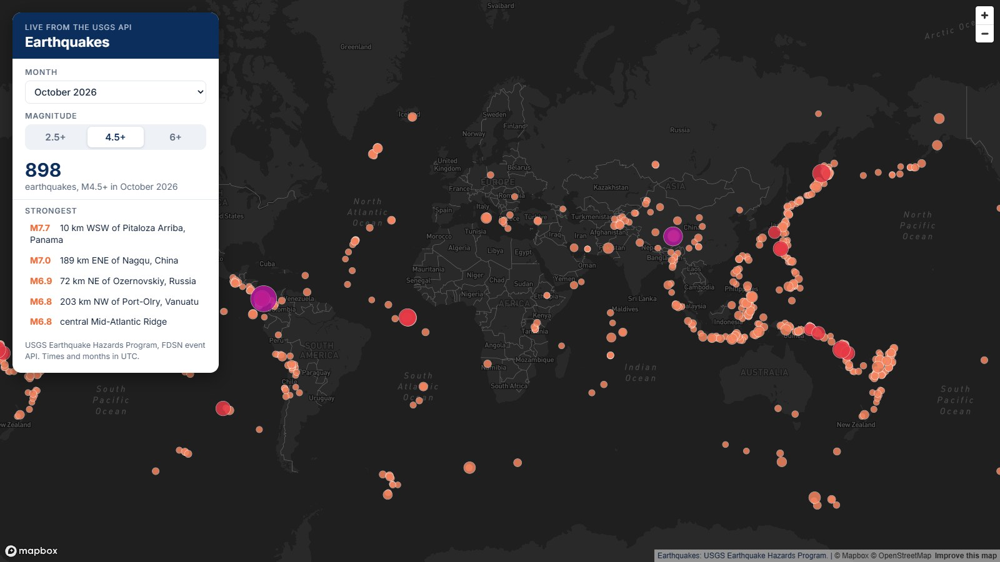

# Load GeoJSON from an API into React + Mapbox (TypeScript)

Source code for the Geo Intelligence Lab video **"Load GeoJSON from an API into React + Mapbox (TypeScript)"**.

A world map of earthquakes fetched live from the USGS API: pick a month and a minimum magnitude, and React
fetches fresh GeoJSON; pick one of the strongest quakes, and the map flies to it. Built with React, TypeScript,
Vite and Mapbox GL JS. No data file, no backend, no API key for the data.



## What's inside

| Folder | What it is |
|---|---|
| [`starter/`](starter) | The broken version, with three bugs. Fix it with the video |
| [`final/`](final) | The finished app shown in the video |

The finished app covers:

- **The request is a URL:** month and magnitude become `starttime`, `endtime` and `minmagnitude` on the USGS
  FDSN event API, with `format=geojson`
- **Typing the response:** `FeatureCollection<Point, QuakeProps>` from `@types/geojson`. The cast is a promise
  to TypeScript, not a check at runtime
- **Add the source once:** an empty source on `load`, then every response goes in with `setData`. Calling
  `addSource` again throws `There is already a source with ID "quakes"` and takes the React app down
- **Cancel the old request:** an `AbortController` per fetch, aborted in the effect's cleanup, so a slow old
  response can't replace the one you asked for
- **GeoJSON is `[lng, lat]`:** USGS adds depth in km as the third value. Read them as `[lat, lng]` and a quake in
  Panama sends the map to Antarctica

## Where each idea lives (`final/src`)

| File | What it teaches |
|---|---|
| `usgs.ts` | Builds the API URL and fetches it, with an abort signal |
| `types.ts` | What the response looks like, in TypeScript |
| `App.tsx` | Month and magnitude state, and the effect that fetches (and cancels) |
| `components/MapView.tsx` | The source added once, `setData`, the fly-to and popups |
| `map/layers.ts` | The circle layer, sized and coloured by magnitude |
| `map/popup.ts` | A quake's popup (depth from the third coordinate), built from text nodes |
| `components/Panel.tsx` | Month, magnitude, count and the strongest quakes |

## Run it

```bash
cd final              # or starter
npm install
cp .env.example .env  # put your public Mapbox token (pk.…) in .env
npm run dev
```

Then open http://localhost:5173.

## Data

Earthquakes: U.S. Geological Survey, Earthquake Hazards Program, FDSN event web service
(https://earthquake.usgs.gov/fdsnws/event/1/), public domain. Fetched live; USGS keeps revising its catalogue,
so counts can change by a few from one day to the next. Times and months are UTC.
Basemap © Mapbox © OpenStreetMap.

## More

- Free GIS Developer Starter Kit: [geointelligencelab.com/toolkit](https://geointelligencelab.com/toolkit)
- YouTube: [@GeoIntelligenceLab](https://www.youtube.com/@GeoIntelligenceLab)
- Work with me: [geointelligencelab.com](https://geointelligencelab.com)
